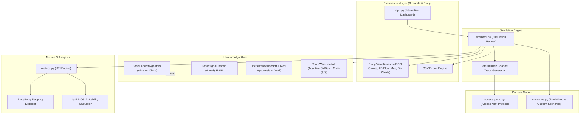
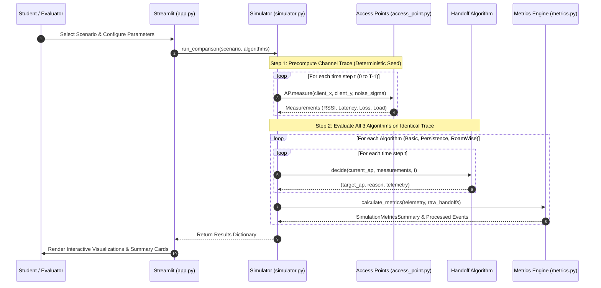

# RoamWise System Architecture

## 1. High-Level Overview
**RoamWise** is an IEEE 802.11 Wi-Fi handoff stability simulation platform. It models access points, radio wave propagation, client mobility, and handoff decision algorithms to evaluate connection stability and Quality of Experience (QoE).

The architecture is built on a clean **modular pipeline**:
1. **Physical & Wireless Environment Layer** (`access_point.py`): Models radio propagation, log-distance path loss, shadow fading, and channel congestion.
2. **Mobility & Scenario Generator** (`scenarios.py`): Defines 2D floor plans, AP deployments, client trajectory paths, and obstacle events.
3. **Roaming Decision Engine** (`handoff_algorithms.py`): Encapsulates the three switching strategies (Basic RSSI, Persistence Hysteresis, and RoamWise Adaptive Stability).
4. **Execution & Telemetry Engine** (`simulator.py`): Executes reproducible runs with a deterministic seed, providing identical channel traces to all algorithms.
5. **Analytics & Performance Engine** (`metrics.py`): Quantifies handoff count, ping-pong frequency, packet delivery ratio, latency, disruption time, and QoE MOS.
6. **Presentation & Interactive Layer** (`app.py`): A Streamlit web dashboard powered by Plotly for live visualization and CSV data export.

---

## 2. Component Architecture Diagram

---

## 3. Data Flow Pipeline

---

## 4. Module Responsibilities

| Module | Primary Class / Function | Responsibility |
| :--- | :--- | :--- |
| `access_point.py` | `AccessPoint` | Implements IEEE 802.11 Log-Distance path loss, shadow fading, load penalties, and QoS degradation calculations. |
| `handoff_algorithms.py` | `BaseHandoffAlgorithm` `BasicSignalHandoff` `PersistenceHandoff` `RoamWiseHandoff` | Implements the decision-making rules for AP association and roaming transitions. |
| `scenarios.py` | `Scenario`, generator functions | Creates 4 standard scenarios (Linear Walk, Fluctuating Boundary, Obstacle, Congested Hotspot) and user-custom setups. |
| `simulator.py` | `Simulator`, `SimulationResult` | Runs algorithms against shared channel traces, ensuring fair scientific benchmarking. |
| `metrics.py` | `calculate_metrics()`, `HandoffEvent` | Detects ping-pong oscillations, computes PDR %, interruption latency, and composite QoE. |
| `app.py` | Streamlit Dashboard | User interface with scenario controls, parameter tuning, Plotly charts, 2D floor maps, and CSV exports. |
| `tests/` | `unittest` test suites | 18 automated unit tests covering mathematical accuracy, algorithm decision logic, and end-to-end simulation. |

---

## 5. Wireless Network Mapping (802.11 Concepts)

In physical IEEE 802.11 networks:
- **Station (STA)**: The mobile client (laptop, smartphone).
- **Access Point (AP)**: The wireless base station transmitting beacon frames every 100ms.
- **Probe Scanning**: The client scans channels (Active probe requests or passive beacon listening).
- **Hard Handoff ("Break-before-Make")**: The client must disassociate from the current AP before completing authentication and association with the new AP. This creates a disruption period of approximately 50ms–150ms.
- **RoamWise's Role**: RoamWise operates as the client's internal roaming decision policy, preventing bad handoff decisions that trigger packet drops.
